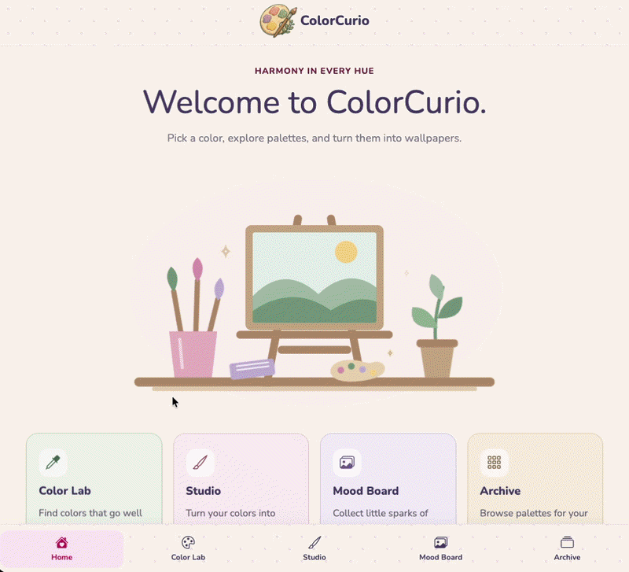

# ColorCurio — Harmony in Every Hue 🌈

Live demo: [mareerray.github.io/ColorCurio](https://mareerray.github.io/ColorCurio/)

ColorCurio is a creative hub for exploring colour harmonies, organising palettes, and collecting mood-board inspiration. Enter a base colour to generate complementary or analogous suggestions, preview palettes in different visual contexts, and extract colour palettes from inspiration images.

<h2>Preview</h2>



## Features

### Colour Lab
- Generate complementary and analogous colour harmonies from a base colour.
- Enter any colour to receive immediate matching-colour suggestions.
- Explore balanced palettes for design and creative work.

### Colour Palette Archive
- Browse 30+ curated sample palettes.
- Search by palette name, mood, or style.
- Click a colour to copy its hex code.
- Use the read-only archive as a reliable source of inspiration.

### Studio
- Preview a selected palette in four frame styles: landscape, web page, poster, and brand.
- Choose from palettes preloaded from the Color Palette Archive.
- Switch between palettes to compare how each one works in different visual contexts.
- Download the generated palette preview (in progress).
- Wallpaper Builder: create custom wallpapers from a selected palette (coming soon).

### Mood Board
- Upload inspiration images and automatically extract a 10-colour palette.
- Detect diverse colours, including gold, purple, red, pink, and accent shades.
- Click a swatch to copy its hex code.
- Download an image with its palette or copy all extracted colours.
- View images in a responsive grid and fullscreen lightbox.
- Store up to 15 custom images, with warnings as the limit approaches.
- Delete custom images; built-in sample images remain protected.

## Tech Stack

- HTML5
- CSS3
- Bootstrap
- Vanilla JavaScript with modular files
- Google Fonts
- Font Awesome
- LocalStorage for saving mood-board items
- JSON for sample palettes and sample mood-board content

## Project Structure

```text
├── index.html
├── style.css
├── home.css
├── colorlab.css
├── archive.css
├── palettes.css
├── moodboard.css
├── app.js
├── modules/
│   ├── layout.js
│   ├── home.js
│   ├── colorlab.js
│   ├── archive.js
│   ├── palettes.js
│   └── moodboard.js
├── assets/
│   ├── images/
│   ├── palettes/
│   │   └── samplePalettes.json
│   └── moodboard/
│       └── sampleMoodBoard.json
└── README.md
```

## Getting Started

1. Clone or download the repository.
2. Open `index.html` in a modern browser.
3. For full functionality, run the project through a local server.
4. Explore the Colour Lab, Archive, Studio, and Mood Board.

## Usage

- **Colour Lab:** Enter a base colour to explore complementary and analogous harmonies.
- **Archive:** Search curated palettes and click a swatch to copy its hex code.
- **Studio:** Preview archive palettes in landscape, web-page, poster, and brand frames.
- **Mood Board:** Upload an image, review its generated palette, copy colours, or download the image with its palette.
- **Storage:** Custom palettes and mood-board images are saved in the browser using LocalStorage.

## Notes

- Custom palettes and mood-board images are stored locally in the browser.
- Studio palette previews can currently be explored using palettes from the archive.
- Studio preview downloads and the Wallpaper Builder are under development.
- Mood-board image uploads support JPG and PNG files under 2 MB.
- The app works best in current versions of Chrome, Firefox, Safari, and Edge.

## License

This project is for personal and educational use.

**Creator:** [Mayuree Reunsati](https://github.com/mareerray)  
**Repository:** [github.com/mareerray/ColorCurio](https://github.com/mareerray/ColorCurio)